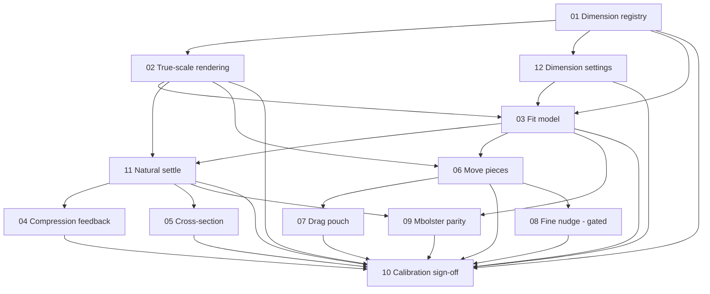

# X-ray pillow UX: vertical slices (issues)

Tracer-bullet breakdown of the PRD (`../xray-pillow-ux-prd.md`). Slice 11 (natural settle) was added on 2026-09-21 from Ivan's second brief and builds between 03 and 04; slice 12 (dimension settings) on 2026-09-25 from his request for a place to configure the numbers, and builds straight after 01. Each slice is a thin, demoable path through the pure model, the renderer and the three surfaces, and leaves a vitest or `.check.ts` behind.

- **Triage label:** `needs-triage` (all slices)
- **Tracker:** [#200](https://github.com/ivanyeors/mp/issues/200) is the PRD issue. Each slice is a sub-issue (#201–#210, #212, #214). Project **mp**: add #200 to the board by hand and its sub-issues follow automatically (the sub-issue workflow that put #167–#183 on the board two seconds after #166 was added).
- **Start here:** slice 01 needs Ivan's measurements; slice 02 can be built against placeholders in parallel and verified once they land.

## Slices

| # | Title | Type | Pri | Status | Blocked by | User stories |
|---|-------|------|-----|--------|------------|--------------|
| [01](https://github.com/ivanyeors/mp/issues/201) | Dimension registry, glossary and ADR 0019 — real measurements in code | HITL | P1 | code half built (PR #213); Ivan's pouch / Neck support numbers pending | none | 5–7, 49 |
| [02](https://github.com/ivanyeors/mp/issues/202) | True-scale rendering — pouches at their footprint relative to the pillow Size | AFK | P1 | built (PR #213); true scale again and Size-relative from M (PR #215) | 01 | 1–4, 46, 47 |
| [03](https://github.com/ivanyeors/mp/issues/203) | Fit model — width and loft budgets, compression limits, fit status | AFK | P1 | built (PR #213) | 01, 02 | 8–11, 13, 22 |
| [04](https://github.com/ivanyeors/mp/issues/204) | Compression feedback and error handling in the editor | AFK | P1 | built (PR #213) | 03, 11 | 12, 14–21 |
| [05](https://github.com/ivanyeors/mp/issues/205) | Cross-section view — live across / along cut on every surface | AFK | P1 | built (PR #213) | 03, 11 | 23–30 |
| [06](https://github.com/ivanyeors/mp/issues/206) | Move pieces — select, keyboard moves, Undo | AFK | P1 | built (PR #213); move pad retired for the drag (PR #215) | 02, 03 | 31–36, 38–40 |
| [07](https://github.com/ivanyeors/mp/issues/207) | Drag a pouch onto another cell or Layer | AFK | P2 | built (PR #213); every move, any Section, Layer sunburst (PR #215), retired 8-11-2026 for a drop on the top Layer (slice 14) | 06 | 37, 38 |
| [08](https://github.com/ivanyeors/mp/issues/208) | Fine nudge — persisted mm offsets | AFK | P2 | built ahead of 10 at Ivan's request (PR #215); migration applied | 06 | 41–43 |
| [09](https://github.com/ivanyeors/mp/issues/209) | Mbolster parity — capsule dimensions, physical cap, end-on cut | AFK | P2 | built (PR #213); bolster measurements pending | 03, 11 | 44, 45 |
| [10](https://github.com/ivanyeors/mp/issues/210) | Physical calibration sign-off | HITL | P1 | ready for sign-off; needs Ivan's measurements (01) | 01–09, 11 | 48 |
| [11](https://github.com/ivanyeors/mp/issues/212) | Natural settle — fill spreads into an empty neighbouring sub-section, on screen and in the loft arithmetic | AFK | P1 | built (PR #213); spread capped by the fabric 17-10-2026 (slice 13) | 02, 03 | 50–62 |
| [12](https://github.com/ivanyeors/mp/issues/214) | Dimension settings — loft allowance, pouch and Neck support dimensions editable in Settings | AFK | P1 | built (PR #213) | 01 | 63–66 |
| [13](13-cross-section-editing.md) | Edit on the cross-section — drag between columns, Layers and Sections; puffy pouches inside the pillow, never squashed, no rubber band; heights audited | AFK | P1 | built; awaiting Ivan on a deployed build | 05, 07, 11 | — |
| [14](14-linked-views.md) | Linked views — the top view and the cut draw one position and follow each other's drag live; precise by default (slow = fine, snaps, badge), no Layer picker; faster outlines | AFK | P1 | built; awaiting Ivan on a deployed build | 08, 11, 13 | — |

## Dependency graph

## Suggested order

1. **Now:** 01 (Ivan's measurements as the code defaults) and 02 in parallel — 02 builds against placeholders. Then 12 straight after 01, so Ivan can maintain the numbers in Settings and the fit reads them from day one.
2. **Spine:** 03, then 11 (settle sits between the fit model and the surfaces that display it), then 04 and 05 in parallel (different files: the renderer panel vs a new component).
3. **Moves:** 06, then 07.
4. **Bolster:** 09 any time after 03.
5. **Close:** 10. (08 was meant to wait on it; Ivan asked for it on 28-9-2026, so 10 now checks it instead of deciding it.)

## HITL notes

- **Slice 01:** the pillow table is filled from the drawings; the pouch, Neck support and Mbolster tables in the PRD's Further Notes seed the code defaults. Once slice 12 ships, an entry Ivan has not provided is *unmeasured* in Settings and a fallback in the x-ray, and he types it in there — the tables seed but do not block.
- **Slice 10:** a ruler, three real builds, a Staff member who has not read the PR, a tablet and a phone. Enter pouch and Neck support sizes as they sit in a **Size M** pillow; the other Sizes scale from M (PR #215).

## Schema

Slice 12 carries `20260925090000_dimension_overrides.sql` (`filling_dimension_overrides`, `neck_support_dimension_overrides`) and slice 08 `20260928090000_filling_placement_offsets.sql` (`offset_x_mm`, `offset_y_mm`, additive and nullable). Both are applied to production, and the migration history matches the repo filenames (28-9-2026).

Prefer `supabase db push`. If a migration must go through the Supabase connector instead, the connector records it under its own timestamp: rename that `supabase_migrations.schema_migrations` row to the file's version in the same sitting, or the next `db push` will stop on the mismatch.
