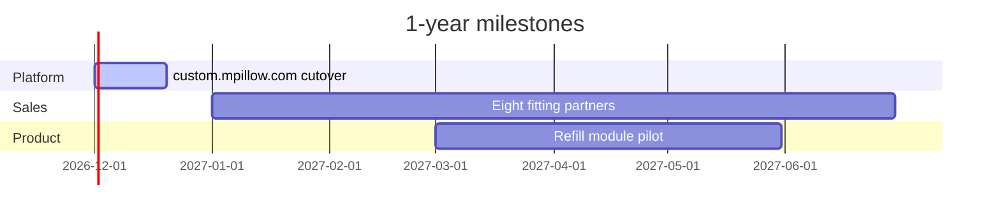

# Agent 0 · CEO / Chief of Staff · Nov 2026

Status: OK

Headline: Partner and B2B work is moving; delivery and follow-up data are the gaps to close before the December launch.

## Numbers (max 5)

| KPI | Now | Before | Target | Status | Source |
|---|---|---|---|---|---|
| Orders in October (Stripe only) | 31 | — | 48 | amber | fin |
| Fitting partners signed | 2 | 1 | 8 | amber | partner |

## Findings (max 3)

None

## Decisions for Ivan (max 3)

- ceo-2026-11-1: Book a licensed pen test before the December launch? | Options: A: book now / B: after launch | Recommend: A | Why: payments go live in December | Impact: SGD 3K | Reversible: yes | Decide by: 5 Dec 2026 | Draft: none

## Drafts awaiting approval

None

## OKR progress

| KR id | Key result | Current | Target | Status |
|---|---|---|---|---|
| KR2.2 | Orders a month (average) | 31 (Stripe only) | 48 | At risk |
| KR3.1 | Tracked searches showing Mpillow | 3 of 10 | 5 of 10 | At risk |
| KR4.1 | Fitting partners signed | 2 | 8 | On track |
| KR5.2 | Open Critical/High security findings at cutover | 2 | 0 | Off track |
| KR6.1 | Order-to-door time | Not measured | 5 working days | Not measured |

## Backlog

None

## Alerts

None

## Data gaps

None

## Roadmap

