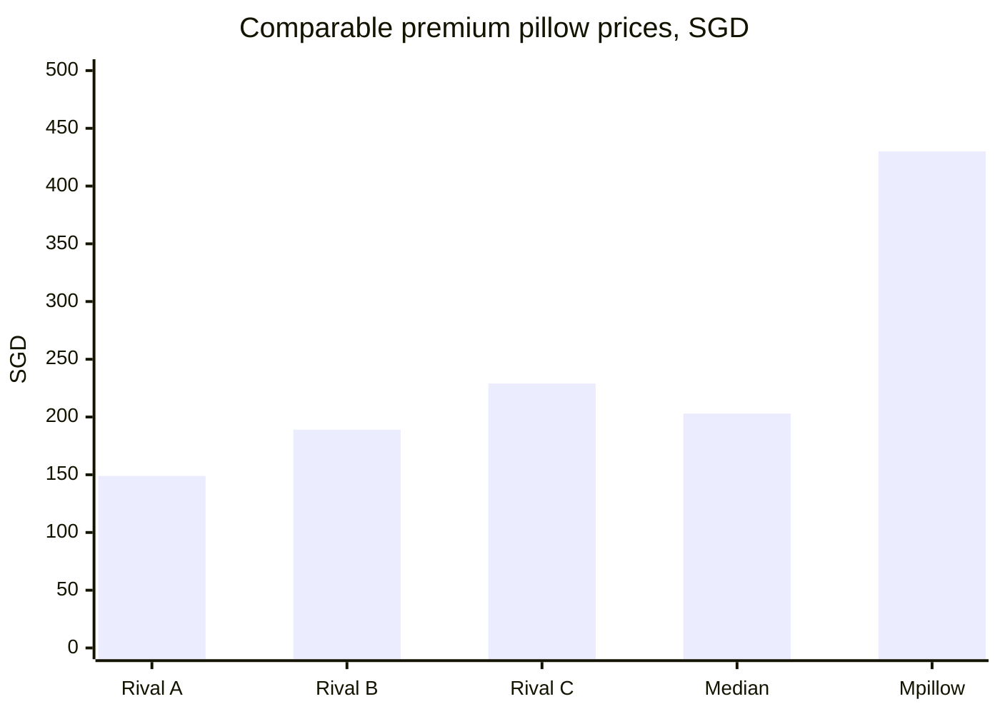

# Competitive Intelligence · Oct 2026

Status: OK

Headline: Mpillow's premium pillow sits 112% above the median comparable price; three rivals cut prices for 11.11.

## Numbers (max 5)

| KPI | Now | Before | Target | Status | Source |
|---|---|---|---|---|---|
| Premium vs median comparable | +112% | — | — | amber | price index, in code |
| Rivals refreshed | 10 of 10 | — | 10 | green | price index |

## Findings (max 3)

None

## Decisions for Ivan (max 3)

None

## Drafts awaiting approval

None

## OKR progress

| KR id | Key result | Current | Target | Status |
|---|---|---|---|---|
| compintel-1 | Price index of top 10 rivals refreshed | 10 of 10 | Monthly | On track |

## Backlog

None

## Alerts

None

## Data gaps

- Shopee listings need a login and were skipped.
