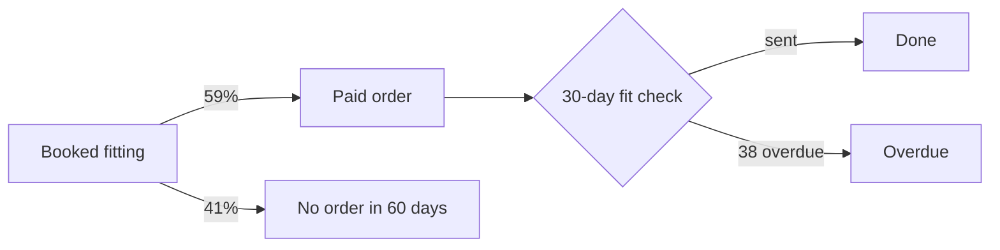

# CRM & Customer success · Week to 24 Nov 2026

Status: Degraded

Headline: 38 fit checks are 8+ days overdue with no logged follow-up, and 9 fittings were cancelled this week.

## Numbers (max 5)

| KPI | Now | Before | Target | Status | Source |
|---|---|---|---|---|---|
| Fit checks overdue 7+ days | 38 | 34 | 0 | red | Supabase count of orders 23–37 days old |
| Booked-not-bought, last 60 days | 41% | 44% | under 50% | green | Supabase bookings vs paid orders |
| Refunds + remake threads | 2 | 1 | 0 | amber | Stripe refunds + Gmail search |
| Happy customers eligible for a review ask | 24 | 19 | more than 0 | green | Supabase, opted in, no remake |
| Consent unknown share | 31% | 33% | under 20% | amber | Supabase consent events |

## Findings (max 3)

- Cancelled fittings cluster on Saturdays: 6 of 9 — evidence: Supabase bookings by weekday — confidence: medium — new since last report: yes
- No field records that a fit check was sent, so crm-1 cannot be measured — evidence: schema review — confidence: high — new since last report: no

## Decisions for Ivan (max 3)

- crm-2026-11-1: Add a "fit check sent" date to orders so follow-ups can be measured? | Options: A: add the field / B: keep counting by hand | Recommend: A | Why: crm-1 stays "Not measured" without it | Impact: SGD 0 | Reversible: yes | Decide by: 1 Dec 2026 | Draft: none

## Drafts awaiting approval

- doc — Follow-up templates, EN and 中文 — [2026-11-24_crm_draft_templates.md](https://drive.google.com/file/d/sample-templates/view)

## OKR progress

| KR id | Key result | Current | Target | Status |
|---|---|---|---|---|
| crm-1 | Post-fitting follow-ups done within 30 days | Not measured | 100% | Not measured |
| crm-2 | Review and referral asks to happy customers a month | 0 | To set | Off track |

## Backlog

| Item | KR id | Score | Now/Next/Later | Runs in Now |
|---|---|---|---|---|
| Fit-check field proposal | crm-1 | 9 | Now | 2 |
| Saturday cancellation pattern | crm-1 | 6 | Now | 1 |

## Alerts

- high — 38 customers are past their 30-day fit check with no follow-up logged. — deadline: none

## Data gaps

- GA4 is not connected, so web conversions are not visible.
