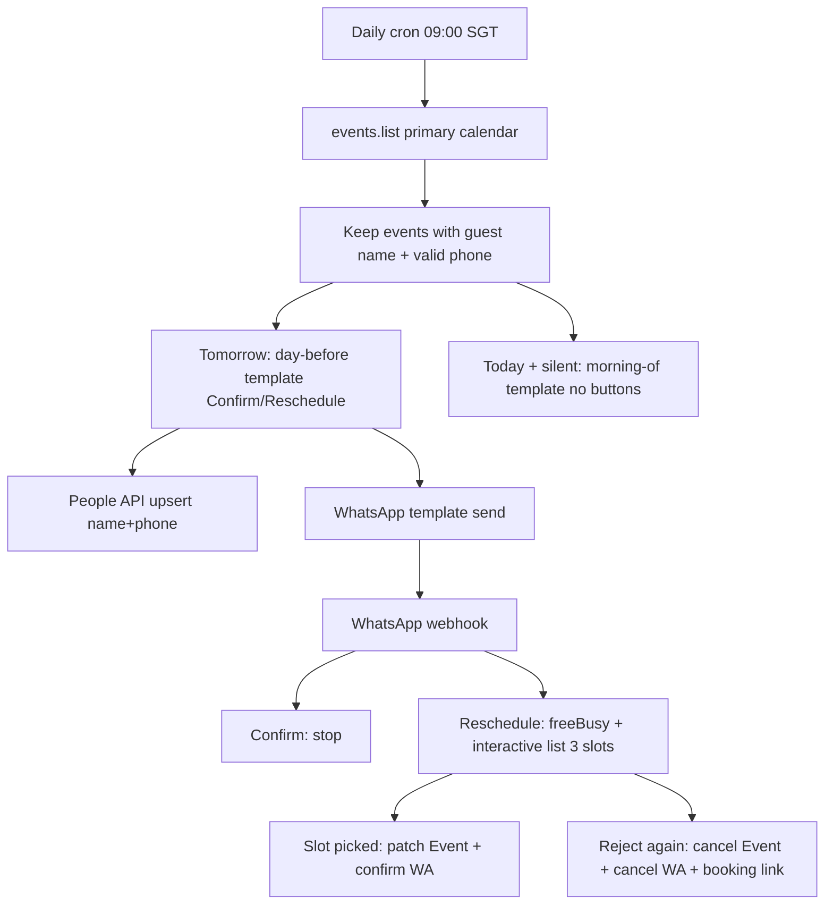

# WhatsApp appointment confirm (v1)

## Scope (locked)

- **In:** Calendar Events → WhatsApp ask/confirm/reschedule/cancel; morning-of nudge if silent; Google Contacts upsert; Settings for venue/hours/days/links.
- **Out:** Booking↔Order journey (later). Chinese templates. Rebuilding booking UI. Dedicated Google “Bookings API” (does not exist — use [Calendar API Events](https://developers.google.com/workspace/calendar/api/guides/overview)).

## Flow

## Manual setup (before / alongside code)

1. **Meta WhatsApp Cloud API** on `+65 8780 5311` with **Business app coexistence** (same inbox).
2. **System user token** with `whatsapp_business_messaging`, `whatsapp_business_management`, `business_management`.
3. **Approve English utility templates** (names TBD in code constants):
   - Day-before: body with date/time/type; quick replies **Confirm** / **Reschedule**.
   - Morning-of: friendly see-you message with date/time/place (no buttons).
   - Cancel (if outside 24h window when needed): cancelled + matching rebook link; else service text inside window.
4. **Google Cloud** project for `admin@mpillow.com`: enable Calendar API + People API; OAuth client; one-time consent; store refresh token in env (scopes: calendar + contacts).
5. Confirm phone syncs Google Contacts for that account so WhatsApp shows names.
6. Dump one real Customisation + Re-adjustment Event JSON once to lock summary matching (`Mpillow Customisation` / `Mpillow Re-adjustment`).

## Backend architecture

Reuse patterns from [`app/api/cron/results-sla/route.ts`](app/api/cron/results-sla/route.ts) (`CRON_SECRET` Bearer) and [`app/api/results/sla-settings/route.ts`](app/api/results/sla-settings/route.ts) + [`lib/site-settings.ts`](lib/site-settings.ts).

| Piece | Approach |
|-------|----------|
| Cron | New `/api/cron/appointment-reminders` at `0 1 * * *` (09:00 SGT). Hobby allows a second cron alongside existing SLA job — verify at deploy; if capped at 1, invoke from SLA route as last resort. |
| Calendar | OAuth as `admin@mpillow.com`; `GOOGLE_CALENDAR_ID=primary`. List tomorrow + today; filter: not cancelled, not all-day, parseable phone + guest name. Type from `summary` → customisation vs readjustment. |
| Phone | Normalize to E.164 (SG-friendly); skip invalid; idempotent per `calendar_event_id` + message kind; non-prod allowlist. |
| WhatsApp | Thin client: send template / interactive list / text. Webhook verify + handle button/list replies. |
| Reschedule | `freeBusy` + settings (duration 60, Tue–Sun, 10:00–18:00 last start, Asia/Singapore, 3 slots, ~14d lookahead). Patch event times; WhatsApp “new time confirmed”. |
| Cancel | `events.delete` (or cancel); WhatsApp + link: [Customisation](https://calendar.app.google/wtLKP75zQRDB5gqC7) or [Re-adjustment](https://calendar.app.google/RGe6GCxzBhX1coGV8). |
| Contacts | On reminder send: People API search-by-phone upsert display name. |
| State | Supabase table e.g. `appointment_reminders` keyed by `calendar_event_id`: phone, name, type, starts_at, status (`pending` / `reminded` / `confirmed` / `offering_slots` / `rescheduled` / `cancelled` / `morning_sent` / `skipped_invalid_phone`), offered slot ids, wa message ids. |
| Settings UI | `/settings/appointments` under General: venue (default `512 Chai Chee Lane Singapore 469028 #02-10`), duration, open/close (last bookable start), bookable days, two booking URLs, summary match strings. API like SLA settings → `site_settings`. Secrets stay in env. |

## Key files to add/touch

- [`vercel.json`](vercel.json) — second cron entry
- `app/api/cron/appointment-reminders/route.ts`
- `app/api/webhooks/whatsapp/route.ts` (or similar)
- `lib/appointments/*` — calendar, slots, phone, whatsapp, contacts, settings parse, state machine
- `app/api/settings/appointments/route.ts` + `app/[lang]/settings/appointments/page.tsx`
- [`components/settings/settings-sidebar-nav.tsx`](components/settings/settings-sidebar-nav.tsx) + breadcrumbs
- Migration for `appointment_reminders`
- [`.env.example`](.env.example) — Google OAuth, calendar id, WhatsApp token/phone-number-id/verify token, optional non-prod allowlist
- [`CONTEXT.md`](CONTEXT.md) — domain terms: **Appointment**, **Appointment reminder**, schedule types (no Order link)

## Env (illustrative)

`GOOGLE_OAUTH_CLIENT_ID`, `GOOGLE_OAUTH_CLIENT_SECRET`, `GOOGLE_OAUTH_REFRESH_TOKEN`, `GOOGLE_CALENDAR_ID=primary`, `WHATSAPP_TOKEN`, `WHATSAPP_PHONE_NUMBER_ID`, `WHATSAPP_VERIFY_TOKEN`, `WHATSAPP_APP_SECRET` (signature), template name envs, `CRON_SECRET`, `WHATSAPP_ALLOWLIST` (non-prod).

## Runnable check

Small assert/self-check or unit tests for: phone normalize/validate; freeBusy slot carving (no overlap, last start 18:00); summary → booking link; reminder state transitions (confirm / offer / reschedule / cancel / morning-of only if silent).

## Deliverable shape for you

Step-by-step ops checklist in the PR/issue: Meta app → templates → coexistence → Google OAuth → env on Vercel → webhook URL → seed settings → book a test slot → wait for cron or hit cron with secret → tap Confirm/Reschedule in WhatsApp → verify Calendar + Contacts + Business app thread.
