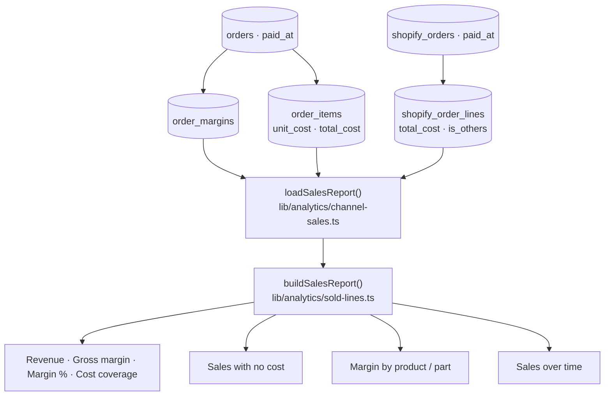

# Analytics: how a sale becomes a margin figure

Where every money figure on Admin Panel → Analytics comes from, how each sale
gets its cost, and what happens when it has none. Terms follow `CONTEXT.md`;
the decision is ADR 0036. Verified against production data on 2026-10-28.

## One set of facts

`getSalesReport` reads each paid Order and each mirrored Shopify order once, turns
it into a sold order with the product revenue it earned and its lines, and
`buildSalesReport` sums everything on the Sales & margin tab from those. The
cards, the breakdown and the timeline therefore add up to the same totals.

- **Revenue** is product revenue after discounts and refunds, before shipping
  and tax.
  - An Order's comes from `order_margins` (gross margin + COGS: the subtotal
    less discount, scaled by refunds through the money ledger).
  - A Shopify order's is read from the mirror as recorded: its lines' gross
    less `amount_refunded`.
  - An order's revenue is spread over its lines by list price.
- **COGS** is the cost frozen on each line when it sold, less restocked returns.
- **Gross margin** is costed revenue minus COGS, and **Margin %** is a share
  of costed revenue.
- **Cost coverage** is the share of revenue whose cost is known.

## A sale with no cost is never $0 cost

A line with no frozen cost is reported as uncosted revenue. It stays in
Revenue, out of the margin, and appears under **Sales with no cost**. Before
2026-10-28 such lines counted as costing $0, which showed their whole revenue
as profit; that is how the page reported 86.6% for May–Oct 2026, when $37,216
of $86,306 of sales had no cost.

The Shopify order mirror is a read-only input (`CONTEXT.md`): Analytics reads
its costs as stored and works out none of its own. A Service takes no stock;
its line carries the cost set in Costings → Service fees, and none (counted as
$0) when that is blank.

## How a platform sale is costed

| Channel | Written by | Cost of one unit |
|---|---|---|
| Shop | `POST /api/shop/checkout` | The Items `stockLinesForOrderItem` deducts for it: the chosen cover and case, the recipe and the fillings (`orderLinesCosts`) |
| Staff-made Order | `POST /api/shop/orders` | The same, per Variant line. A line with no Variant has no cost |
| Result | `POST /api/results/[id]/accept` | `assembleBuild`'s COGS for the build frozen on the line |
| Service | Result accept, `POST /api/readjustments/checkout` | `service_prices.cost_price` |

An Item with no cost price counts as $0, as Result accept and the Costings
build cost count it. Until 2026-10-28 shop checkout costed a customised pillow
from its Variant's `cost_price`, which is its recipe's cost; a recipe carries
no fillings (ADR 0003), so the fillings were left out.

## Months, paging and stock

- **Singapore months.** The client sends the instants `sgMonthRangeIso`
  returns, and every loader reads them back with `sgMonthRange`
  (`lib/analytics/sg-calendar.ts`). A server in UTC used to re-snap them to its
  own midnight, which pulled the previous month in: 230 orders reported for a
  May–Oct range that held 210.
- **Every read pages** (`lib/supabase/select-all.ts`). Supabase returns at most
  1,000 rows without an error. The inventory waterfall read one page of a
  2,389-row ledger, stopped at 9 Jul 2026, and closed at 19,438 units against
  the 17,203 that `inventory_balances` held.
- **Inventory movement** (Stock & builds tab) sums the whole ledger to each
  boundary. Balances are signed, as Inventory shows them, so the closing total
  for the current month matches the Inventory page.
- **Stock value today** (at cost and at MSRP) is an as-of-now figure on
  Costings, not Analytics (ADR 0006).

## The tabs

| Tab | Question | Cards |
|---|---|---|
| Sales & margin | What did we sell, what did it cost, what did we keep? | KPIs, Sales with no cost, Margin by product / part, Sales over time |
| Stock & builds | How did stock move, and what goes into each build? | Inventory movement, Stock value link, Product configuration |
| Customers | Who customises with us, and what stops people buying? | Results answers, Why people leave |
| Traffic & search | How do people find the site, and where do they go next? | Search visibility, Prospect journey |

`?tab=` keeps a tab linkable. A tab mounts only while open, so it loads only
its own cards. The period applies to every tab except Search visibility, which
keeps its own range.
