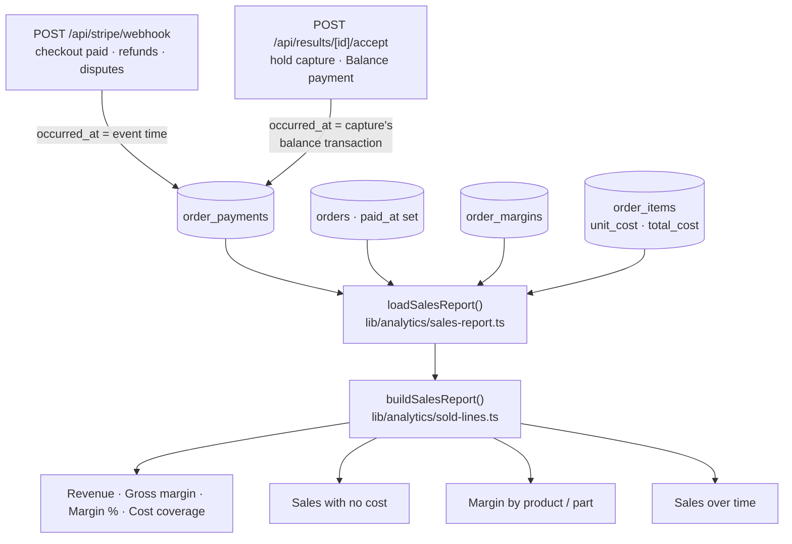

# Analytics: how a sale becomes a margin figure

Where every money figure on Admin Panel → Analytics comes from, when a sale
counts, how it gets its cost, and what happens when it has none. Terms follow
`CONTEXT.md`; the decision is ADR 0036.

Analytics tracks this site's sales only. Shopify is not read.

## A sale is what Stripe took

Every platform payment goes through Stripe: shop Checkout, a Result's
Authorization hold and its capture, a Balance payment by link or at the
counter reader, and a re-adjustment fee. The money ledger (`order_payments`) is
written only from those: the Stripe webhook and Result Accept.

- **When a Sale counts.** An Order is a Sale once its ledger holds a Stripe
  `charge` and the payment flow has confirmed it (`paid_at` set). A payment
  that lands on a cancelled Order is flagged for Staff to refund or reinstate,
  and is not a Sale until then.
- **When it is dated.** By its latest charge's `occurred_at`, Stripe's own time
  for the money, never by when our code wrote the row:

  | Ledger row | Written by | `occurred_at` |
  |---|---|---|
  | Shop / re-adjustment charge | `checkout.session.completed` / `async_payment_succeeded` | the event's `created` (for PayNow, when the money settled) |
  | Result hold capture | Accept | the capture's balance transaction (`paymentIntentCapturedAt`) |
  | Result Balance payment | Accept | the same, for the Balance payment's intent |
  | Refund | `charge.refunded` | the refund's `created` |
  | Dispute loss and fee, refund reversal | `charge.dispute.closed`, `refund.failed` | the event's `created` |

  A Result paid in two parts (a Balance payment, then the hold's capture) is
  sold when the second lands: the moment Stripe held the whole price. A
  customer who paid a Balance payment and closed the tab is dated by that
  payment, however late Accept ran. `orders.paid_at` carries the same Stripe
  time.
- **Revenue** is product revenue after discounts and refunds, before shipping
  and tax: `order_margins`' gross margin + COGS, which the ledger scales down
  for refunds and lost disputes. A refund comes off the Sale it belongs to.
  An Order's revenue is spread over its lines by list price.
- **COGS** is the cost frozen on each line when it sold, less restocked
  returns. **Gross margin** is costed revenue minus COGS, and **Margin %** is a
  share of costed revenue. **Cost coverage** is the share of revenue whose cost
  is known.

The cards, the breakdown and the timeline are all sums of the same sold lines,
so they reconcile with each other.

## A sale with no cost is never $0 cost

A line with no frozen cost is reported as uncosted revenue. It stays in
Revenue, out of the margin, and appears under **Sales with no cost**. Before
2026-10-28 such lines counted as costing $0, which showed their whole revenue
as profit; that is how the page reported 86.6% for May–Oct 2026.

A Service takes no stock: its line carries the cost set in Costings → Service
fees, and none (counted as $0) when that is blank.

## How a sale is costed

| Channel | Written by | Cost of one unit |
|---|---|---|
| Shop | `POST /api/shop/checkout` | The Items `stockLinesForOrderItem` deducts for it: the chosen cover and case, the recipe and the fillings (`orderLinesCosts`) |
| Staff-made Order | `POST /api/shop/orders` | The same, per Variant line. A line with no Variant has no cost |
| Result | `POST /api/results/[id]/accept` | `assembleBuild`'s COGS for the build frozen on the line |
| Service | Result accept, `POST /api/readjustments/checkout` | `service_prices.cost_price` |

An Item with no cost price counts as $0, as Result accept and the Costings
build cost count it. Until 2026-10-28 shop checkout costed a customised pillow
from its Variant's `cost_price`, which is its recipe's cost; a recipe carries
no fillings (ADR 0003), so the fillings were left out.

## Months, paging and stock

- **Singapore months.** The client sends the instants `sgMonthRangeIso`
  returns, and every loader reads them back with `sgMonthRange`
  (`lib/analytics/sg-calendar.ts`). A server in UTC used to re-snap them to its
  own midnight, which pulled the previous month in.
- **Every read pages** (`lib/supabase/select-all.ts`). Supabase returns at most
  1,000 rows without an error. The inventory waterfall read one page of a
  2,389-row ledger, stopped at 9 Jul 2026, and closed at 19,438 units against
  the 17,203 that `inventory_balances` held.
- **Inventory movement** (Stock & builds tab) sums the whole stock ledger to
  each boundary. Balances are signed, as Inventory shows them, so the closing
  total for the current month matches the Inventory page.
- **Stock value today** (at cost and at MSRP) is an as-of-now figure on
  Costings, not Analytics (ADR 0006).

## The tabs

| Tab | Question | Cards |
|---|---|---|
| Sales & margin | What did we sell, what did it cost, what did we keep? | KPIs, Sales with no cost, Margin by product / part, Sales over time |
| Sales (a role without Costings) | What did we sell, and what did it bring in? | Revenue, Sales over time. `getSalesReport` sends no COGS, margin, cost coverage, gaps or breakdown |
| Stock & builds | How did stock move, and what goes into each build? | Inventory movement, Stock value link, Product configuration |
| Customers | Who customises with us, and what stops people buying? | Results answers, Why people leave |
| Traffic & search | How do people find the site, and where do they go next? | Search visibility, Prospect journey |

`?tab=` keeps a tab linkable. A tab mounts only while open, so it loads only
its own cards. The period applies to every tab except Search visibility, which
keeps its own range.

## Known gaps

- **The Shopify order mirror is still written and read by nothing.** Its
  webhook, the daily catch-up after the results-SLA cron and the re-resolve on
  a Costings save still run.
- **A $0 Order** (fully discounted) has no Stripe charge, so it is not a Sale
  and its stock cost appears nowhere on Analytics.
