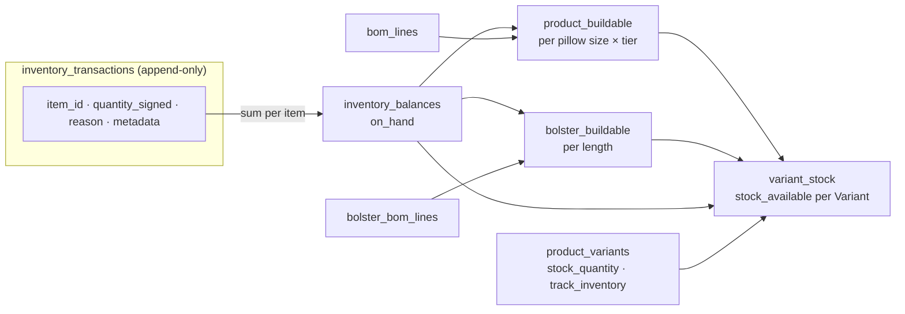
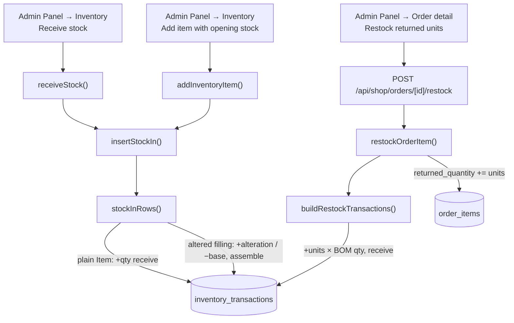
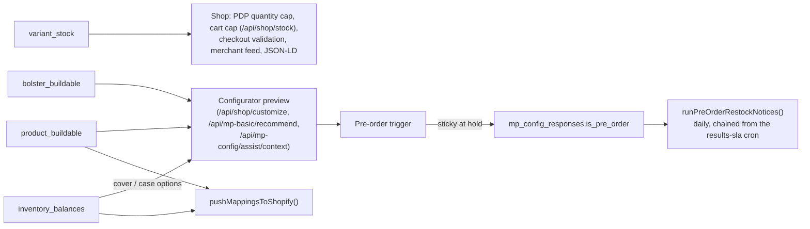

# Inventory: how stock is recorded, added and shown

How on-hand stock is stored, every way it goes up, and how it reaches the shop,
the configurator and Shopify. Stock going *down* because someone bought
something is in [purchases-to-inventory.md](purchases-to-inventory.md).

Terms follow `CONTEXT.md`: **Item**, **Composed sellable**, **Variant**,
**Result**, **Order**, **Filling Template**. Code is named by function, not by
line; `./scripts/graphify explain "<function or table>"` gives current
locations, and `graphify-out/DATA_LAYER.md` lists every reader and writer of a
table.

Verified by reading the code at commit `dfe7696` (2026-10-22), not against the
live database.

## The ledger is the only stock record

- **`inventory_transactions`** (`0001_inventory.sql`) has one row per movement:
  `item_id`, `quantity_signed` (never 0), `reason`, `metadata` jsonb and
  `created_at`. Nothing updates or deletes rows, and no trigger or SQL function
  writes them. Every writer is TypeScript using the service-role client
  (`supabaseAdmin()`), because RLS gives staff read access only.
- **On-hand** is the `inventory_balances` view: `sum(quantity_signed)` per
  `item_id`. An Item with no rows has no balance row; callers treat that as 0.
  **Nothing stops on-hand going negative.** No sell path checks stock before
  writing.
- **`reason`** is the only classifier:

  | reason | sign | written by |
  |---|---|---|
  | `sale` | − | every purchase channel and the manual sells |
  | `receive` | + | Receive stock, initial stock, restock of returned goods |
  | `assemble` | ± | converting a base filling into an altered filling (two rows) |
  | `correction` | | allowed by the check constraint; nothing writes it |
  | `adjustment` | | allowed by the check constraint; nothing writes it |

- **`metadata`** is how writers find their own rows again (idempotency) and
  how analytics attributes a movement:

  | keys | writer |
  |---|---|
  | `order_id`, `customization_id` | shop deduction (`deductInventoryForOrder`) |
  | `order_id`, `result_id`, `role` | Result accept (`role` = composed / filling / preference / addon) |
  | `order_id`, `order_item_id`, `restock`, `stripe_refund_id`? | `restockOrderItem` |
  | `shopify_queue_id`, `shopify_order_id`, `shopify_line_item_id` (+ `template_*` or `replace_lines`) | Shopify commit |
  | `template_*`, `filling_template_*` | manual `sellFromTemplate` |
  | `converted_from_item_id` / `converted_to_item_id` | altered-filling conversion |
  | none | manual `sellPillow`, `sellPart`, `sellBolster`, plain receive |

### What can be built

- **`product_buildable`** (latest definition `0014_pillow_kinds.sql`): for each
  `pillow_products` row (size × tier), the smallest
  `floor(on_hand / quantity)` across its `bom_lines`.
- **`bolster_buildable`** (`0029_ecommerce_inventory_bridge.sql`): the same per
  length over `bolster_bom_lines`. The column is **`bolster_variant`**, not
  `variant`.
- Both cover **non-filling Items only**. Fillings live only in Filling
  Templates (ADR 0003), so filling stock never limits buildable counts,
  `variant_stock` or the Pre-order trigger.

### What the shop shows: `variant_stock`

Latest definition `20260630120000_variant_stock_bolster.sql`. For each Variant,
`stock_available` is the first that applies:

1. `999999` when `track_inventory = false`
2. `product_buildable.buildable` when the Variant has a `pillow_product_id`
3. `inventory_balances.on_hand` when it has an `item_id`
4. `bolster_buildable.buildable` for a bolster product, matched on `option1`
5. otherwise the Variant's own `stock_quantity`. This is the only stock that
   lives outside the ledger. It is edited in the product editor and
   decremented by shop deduction case 6.

The links in 2–4 are set by the **Sync from Inventory** projection
(`lib/ecommerce/inventory-sync.ts`, `lib/ecommerce/from-inventory.ts`).
Storefront products are a projection of inventory; see `CONTEXT.md`.

## Stock in

- **Receive stock** (`receiveStock` → `insertStockIn` → `stockInRows`, in
  `app/[lang]/settings/inventory/actions.ts` and
  `lib/inventory/alteration-stock.ts`) writes one `+qty` `receive` row.
- **Altered fillings** are made from a base filling. Receiving one writes two
  `assemble` rows in one insert: `+qty` on the alteration and `−qty` on the base.
  `assertConvertible` refuses when the base has too little on hand. The read
  and the insert are not one transaction, and the code says so.
- **Opening stock** on a new or revived Item goes through the same
  `insertStockIn`, from `addInventoryItem`.
- **Restocking returned goods** is a deliberate Staff action on the Order
  detail page (`POST /api/shop/orders/[id]/restock`, permission `orders`):
  - `restockOrderItem` resolves Items through the Variant the same way shop
    deduction does, writes `receive` rows and adds to
    `order_items.returned_quantity`.
  - A Result Order line has no Variant. Its restock reverses that Result's
    own `sale` rows (matched on `order_id` + `result_id`).
  - It refuses to return more units than were sold.
  - The ledger insert and the `returned_quantity` update are separate
    statements.
- **Nothing else adds stock.** Specifically:
  - Stripe refunds (`charge.refunded`), cancels and refund requests never
    restock. `lib/ecommerce/restock-order.ts` says so in its header.
  - RMA has no inventory code. An RMA refund settles through the same
    `charge.refunded` path.
  - Shopify refunds only trim mirrored COGS on `shopify_order_lines`.
  - Re-adjustments and other Services consume and return no stock.

## Stock out to the storefront, configurator and Shopify

- **Shop**: `attachStockAvailable` (`lib/ecommerce/products.ts`) adds
  `variant_stock` to every product read. The checkout validates stock but
  **reserves nothing**: stock moves only when payment lands.
- **Configurator / Pre-order** (ADR 0005): the Pre-order trigger
  (`lib/configurator/pre-order-trigger.ts`) is true when a required preference
  (cover/case) has on-hand ≤ 0 or the composed buildable is ≤ 0.
  - At hold, `loadPreOrderTriggerAtHold` recomputes it and stores sticky
    `is_pre_order` on the Result.
  - `runPreOrderRestockNotices` (`lib/configurator/pre-order-restock.ts`) emails
    `held`/`assigned` Pre-order Results once stock recovers. It claims each
    Result by setting `pre_order_restock_notified_at`.
- **Low stock**: the Inventory page's badge comes from
  `collectLowStockCategories` (`lib/inventory/part-category-low-stock.ts`). A
  part category is marked low when it limits builds to 30% or less of what the
  other parts allow. `item_thresholds` and `setThreshold` exist, but nothing
  reads the table and nothing calls the action.
- **Shopify stock levels** are pushed only:
  - after a Shopify sales commit (`syncShopifyInventoryForDepletedItems`), or
  - on a full sync (`fullShopifySync`, `POST /api/shopify/sync`).

  Shop sales, Result accepts, manual sells and receives do not push.
- **Costings KPIs**: on-hand value (at cost, potential MSRP revenue, margin) is
  read as-of-now from `inventory_balances` on the Costings page, not Analytics.

## Known gaps

Found by reading the code, not by running it.

- **The Telegram bot is read-only.** `/stock` shows on-hand and buildable
  counts. Stock moves need a Staff session, so they happen in the Admin Panel.
- **`getAvailableBolsterComponents`** (`lib/shop/customization-inventory.ts`)
  queries a `bolster_products` table no migration creates. It has no caller.
