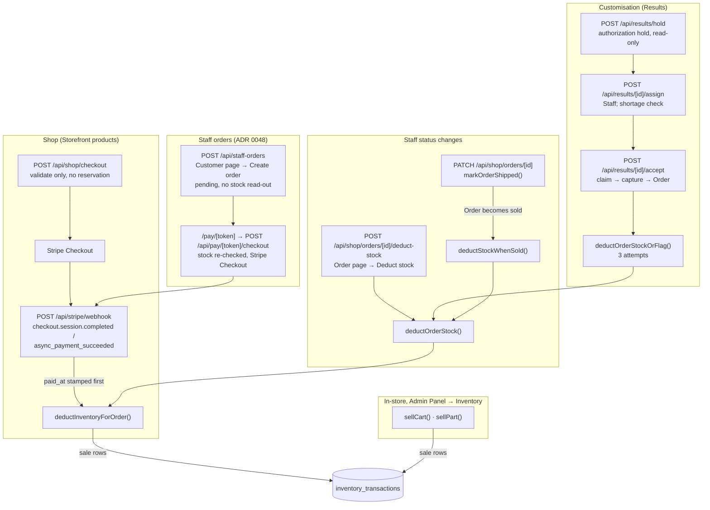

# Purchases to inventory: how a sale takes stock out

Every path by which a purchase removes stock: the entry point, the function
chain, which Items it decides to deduct, and how it avoids deducting twice.
How stock is stored and added is in [inventory.md](inventory.md).

Terms follow `CONTEXT.md`. Verified by reading the code on 2026-10-27, not
against the live database. `./scripts/graphify explain
"inventory_transactions"` lists every writer with its current line.

## Every channel, one ledger

| Channel | Entry point | Stock leaves when | Items come from | Double-deduction guard |
|---|---|---|---|---|
| Shop | `POST /api/stripe/webhook` | After the webhook stamps `paid_at` | The Variant: its Composed sellable's build, its Item, or its own `stock_quantity` | Claim `orders.inventory_deducted_at` |
| Result | `POST /api/results/[id]/accept` | After capture, once the Order exists | The build frozen on the Order line | Claim `orders.inventory_deducted_at` |
| Staff order | `POST /api/stripe/webhook`, as Shop | After the webhook stamps `paid_at` | As Shop (Variants only; Service lines take nothing) | Claim `orders.inventory_deducted_at` |
| Staff status change | `PATCH /api/shop/orders/[id]`, `markOrderShipped` | When the Order becomes sold | As Shop | Claim `orders.inventory_deducted_at` |
| In-store | Inventory page cart | Immediately | Warehouse + Filling Template, or parts | Unique `sale_id` × `sale_line` × Item |

Shopify sales take no stock. This platform replaces Shopify, so the Shopify
webhook only feeds the Shopify order mirror, which Analytics no longer reads
(it tracks this site's sales only, [analytics.md](analytics.md)).

## The claim: one deduction per Order

`orders.inventory_deducted_at` is set by whichever call deducts the Order's
goods, and every other call sees it set and stops.

- **`deductOrderStock(admin, orderId)`** (`lib/ecommerce/order-stock.ts`)
  claims the Order, then deducts every goods line through
  `deductInventoryForOrder`. If the deduction throws, it hands the claim back
  so a retry deducts, and rethrows.
- An Order that already has `sale` rows tagged with its `order_id` is only
  claimed, never deducted again. Rows written before the claim existed count.
  Migration `20261028033625_stock_deduction_guards.sql` back-filled the claim
  on every such Order.
- **`deductOrderStockOrFlag`** tries `deductOrderStock` up to N times. If
  every attempt fails, it flags the Order `needs_attention` and writes a
  `stock_not_deducted` timeline event. It never throws, because the sale has
  already happened.
- The Stripe webhook keeps its own claim on the same column, and calls
  `deductInventoryForOrder` directly.
- **Deduct stock** on the Order page (`POST /api/shop/orders/[id]/deduct-stock`,
  permission `orders`) runs `deductOrderStock` for a sold Order with no claim.
  It is the recovery path for every flagged Order.

## Shop: checkout → Stripe → webhook

1. **`POST /api/shop/checkout`** creates the Order (`status 'pending'`) and
   its `order_items`, then a Stripe Checkout Session carrying `order_id`.
   The shopper pays it on our page (`ui_mode: "elements"`: Apple Pay and
   Google Pay above the card and PayNow form) or, without a publishable key
   or Stripe.js, on Stripe's hosted page (ADR 0052). Either way it is the same
   Session, and everything below reads it the same way. Going back from the
   on-page step calls `POST /api/shop/checkout/release`, which expires the
   Session and cancels the Order at once, as `checkout.session.expired` would.
   The Apple Pay button beside the checkout button makes the Order the same
   way, only after the shopper approves in the Apple Pay sheet, then pays its
   Session with that Apple Pay payment method if the Session totals what the
   sheet showed. If not, it charges nothing and opens the on-page step. A
   declined payment releases the Order the same way.
   It validates stock without writing any:
   - Standard lines are checked against `variant_stock.stock_available`.
   - Customised lines are re-quoted from Costings by `quoteCustomization`.
     The quote's canonical `config_lines` / `filling_lines` replace the
     client's. `validateCustomizationConfig` checks `composedBuildLines`
     against `inventory_balances`. These are the same lines the sale deducts.
   - Pillow and bolster lines without a customisation are refused.
2. **`POST /api/stripe/webhook`** handles `checkout.session.completed` and
   `checkout.session.async_payment_succeeded`.
   - Result-hold sessions (a `result_id` with no `order_id`) branch away
     before any Order work.
   - An `unpaid` session (a delayed method still settling) and a total
     mismatch both stop here and flag the Order. Nothing is deducted.
   - Otherwise it sets `status 'confirmed'` and `paid_at`, and **then**
     deducts.
3. **Guard**: it claims the Order by setting `orders.inventory_deducted_at`
   where it is null, and deducts only when the claim lands. A failed
   deduction clears the claim so Stripe's retry deducts.
4. **`deductInventoryForOrder`** (`lib/ecommerce/inventory-deduction.ts`)
   writes the `sale` rows for every goods line in one insert, and throws on
   error. Service lines and Variants with `track_inventory = false` take
   nothing. Each Variant line resolves through `stockLinesForOrderItem`, which
   restock also uses:

   | Case | When | Deducts |
   |---|---|---|
   | 1 Customised bolster | `customization_id` + snapshot, bolster type | The length's build (below) under the snapshot's choices |
   | 2 Pillow | `pillow_product_id` | The size × tier's build, under the snapshot's choices when customised |
   | 3 Plain bolster | `option1` is a length | The length's build |
   | 4 Item-linked Variant (accessory, part) | `item_id` | That Item |
   | 5 Manual Variant | none of the above | **No ledger row.** Lowers `product_variants.stock_quantity`, floored at 0 |
   | 6 Result line | no Variant, a Result build snapshot | The snapshot's `build_lines`, with `result_id` and `role` |

   **A Composed sellable's build** (`composedBuildLines`) is the customer's
   chosen lines, laid over the defaults: the recipe (`bom_lines` or
   `bolster_bom_lines`) and the Default Filling Template's pack. A recipe
   carries no fillings (ADR 0003).
   - A chosen cover or case replaces the recipe's default of that role.
   - Chosen fillings replace the default fillings. A shop bolster offers no
     filling choice, so it always ships its length's default fillings.
   - A chosen Item replaces the recipe line for the same Item.
   - Zero-quantity lines are dropped. The ledger refuses a 0 row.

   A Filling Template's pack (`loadFillingTemplatePack`) is its placements,
   one unit each, or its flat `bom_template_lines` when it has none.

   If the deduction throws, the Order is flagged `needs_attention` with an
   `oversold` timeline event, and the webhook returns 500 so Stripe retries.

## Results: hold → assign → accept

ADR 0002: stock is validated at assign and Accept, and deducted only on
successful capture, never at hold.

0. **Draft mix** (`POST /api/results/[id]/filling-mix`, Staff, from Admin
   Panel → Results, optional). Before the customer submits, Staff may lay
   out the fillings on the Draft Result (status null) and save them into
   `result_filling_placements`, with `filling_fingerprint` /
   `filling_template_id` on the row. Nothing else moves: no status, price,
   hold or email, and no stock is read. Mpillow only: the Mbolster
   configurator creates no Draft Result.
1. **Hold** (`POST /api/results/hold`) places the Stripe authorization hold
   and inserts the Result as `held`. It replaces the Result's filling
   snapshot only when the configurator sends a Staff assist mix, so a mix
   saved on the draft survives a customer's submit. It reads stock only to set sticky
   `is_pre_order`. A discount code is checked here and its terms kept on the
   Result (`coupon_terms`); every later repricing takes them off the goods
   (ADR 0033). A partner's code typed on a customised premium pillow does
   the same with the partner's unused Commission Pool when Staff pass it to
   customers (`coupon_id` null), and the hold fixes the partner's commission
   on the Result (`partner_commission`, ADR 0034). Money only — a discount
   never changes what is built or deducted.
2. **Assign** (`POST /api/results/[id]/assign`, Staff, from Admin Panel →
   Results).
   - Checks shortages against `inventory_balances`. While the customer still
     has to finish, cover and case defaults are excluded from the check.
   - Moves the Result `held → assigned` and snapshots its fillings into
     `result_filling_placements` / `result_bolster_filling_placements`.
   - Finish and reconfigure re-run the same shortage check.
3. **Accept** (`POST /api/results/[id]/accept`, from the customer's Result
   page or the configurator) runs these steps:
   1. `loadAssignedBuild` builds the line list for the Result and any
      Paired-build companion. Any shortage → 409.
   2. **Claim**: conditional update `assigned → accepted` where
      `order_id is null`. This is the exactly-once guard; `releaseClaim`
      hands it back if a step before the Order fails.
   3. Capture the hold (`captureHold`), or settle a Balance payment.
   4. Insert the Order with `paid_at = now`. Each build becomes one goods
      `order_items` row with `variant_id = null`, whose snapshot freezes the
      build's lines (`build_lines`). Service lines are `kind 'service'` and
      never deducted. A discount code goes on the Order as `coupon_id` /
      `discount_amount`, and the coupon's use is counted. An attributed Order
      holding a customised premium pillow gets one held `commissions` row for
      the hold's `partner_commission` (ADR 0034).
   5. **Deduct**: `deductOrderStockOrFlag(admin, order.id, 3)` writes one
      `sale` row per frozen build line, metadata `{order_id, result_id, role}`.
      It tries three times. If all fail, the Order is flagged and Staff use
      **Deduct stock**. The Accept still succeeds, because the money is captured.
   6. Mark each member Result `captured` with its `order_id`.

   **What gets deducted** is `assembleBuild` (`lib/build-assembly/index.ts`)
   over `loadAssignedBuild` (`lib/results/assigned-build.ts`):
   - the assigned Composed sellable's non-filling BOM (`bom_lines` for size ×
     tier, or `bolster_bom_lines` for the length), minus any role (cover/case)
     the customer chose;
   - the fillings: the Result's placement snapshot, flattened by
     `derivePackList` (one unit per placement), or the assigned Filling
     Template's lines for legacy Results;
   - Customer preference lines, at the BOM's quantity for that role;
   - Add-on lines (`accessories` Items).

## Staff orders (ADR 0048)

A **Staff order** is made on a Customer's page (**Create order**, permission
`orders`) and paid by the customer through its **Payment link**. It takes
stock exactly as a shop Order does, because it is settled the same way:

1. **`POST /api/staff-orders`** prices the draft with `quoteStaffOrder`
   (`lib/staff-orders/quote.ts`): Variants at `product_variants.price`,
   Services at `service_prices.msrp`, the delivery method, a discount code,
   tax. It checks stock per Variant against `variant_stock.stock_available`,
   as checkout does, and writes nothing to the ledger. `createStaffOrder`
   inserts the Order `pending`, its `order_items` (Service lines are
   `kind 'service'`), the courier quote and an `order_payment_links` row.
2. **`POST /api/pay/[token]/checkout`** (the Pay button on `/pay/[token]`)
   checks stock again and opens a Stripe Checkout Session carrying `order_id`
   and `purpose: staff_order`, for the Order's stored total.
3. **`POST /api/stripe/webhook`** confirms it on `checkout.session.completed`
   through the shop branch above: `paid_at` first, then the claim and
   `deductInventoryForOrder`. A `staff_order` session that expires unpaid does
   not cancel the Order; the daily job (`expireStaffOrderLinks`) cancels it
   once the link itself has expired.

`POST /api/shop/orders`, which wrote an Order already sold at prices from the
request body, was retired with this change.

## Staff status changes

`deductStockWhenSold(admin, orderId, before, after)` deducts when an Order
moves from a status that is not sold to one that is (`confirmed`,
`processing`, `shipped`, `delivered`; `lib/ecommerce/sold-status.ts`). An
Order already sold before the change is not deducted again. It runs from:

- `PATCH /api/shop/orders/[id]`, the Order page's status change;
- `updateOrderStatus` and `fulfillOrder` in `app/[lang]/settings/orders/actions.ts`;
- `markOrderShipped`, when an Order nobody confirmed is shipped.

A failure flags the Order, as above.

## In-store: Admin Panel → Inventory

The Inventory page's cart writes `sale` rows straight away, with no Order.
Analytics does not count these as a revenue channel.

| Cart line | Server action | Deducts |
|---|---|---|
| Pillow or bolster: Warehouse Template + Filling Template | `sellCart` | The warehouse template's lines plus the Filling Template's pack (placements first) |
| Part, or the custom pillow/bolster drawers | `sellCart` | Those Items |
| Part drawer, one Item | `sellPart` | That Item |

`sellCart` writes the whole cart in one insert, so it sells whole or not at
all. Each row carries `metadata.sale_id` (one id per cart, made in the
browser) and `sale_line`. A unique index on `sale_id` × `sale_line` × Item
refuses a resubmitted cart, and the action answers "already sold". The Sell
button is disabled while a sale runs.

## Purchases that take no stock

- **Services**: re-adjustment fee Orders and measurement fees are
  `kind 'service'` with no Variant.
- **Orders that never become sold**: `pending`, `cancelled`, `refunded`.
- **Shopify sales**: mirrored only; not counted anywhere.

## Known gaps

Found by reading the code, not by running it.

- **Manual-stock updates run after the ledger insert.** If one of several
  case 5 `stock_quantity` updates fails, the earlier ones stay applied and
  the retry applies them again.
- **A Composed sellable with no Default Filling Template deducts no
  fillings** for a shop line that chose none. Configure should set one for
  every card.
- **Result accept checks then inserts.** The shortage check and the ledger
  insert are not atomic. The claim CAS makes the Order exactly-once, but not
  the stock check.
- **Restock of a shop line re-resolves its build today.** An Order sold
  before 2026-10-27 that deducted both the default and the chosen cover gets
  only the chosen one back.
