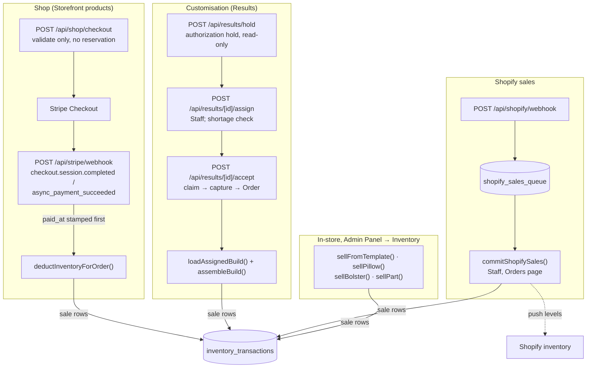

# Purchases to inventory: how a sale takes stock out

Every path by which a purchase removes stock: the entry point, the function
chain, which Items it decides to deduct, and how it avoids deducting twice.
How stock is stored and added is in [inventory.md](inventory.md).

Terms follow `CONTEXT.md`. Verified by reading the code at commit `dfe7696`
(2026-10-22), not against the live database. `./scripts/graphify explain
"inventory_transactions"` lists every writer with its current line.

## Four channels, one ledger

| Channel | Entry point | Stock leaves when | Items come from | Double-deduction guard |
|---|---|---|---|---|
| Shop | `POST /api/stripe/webhook` | After the webhook stamps `paid_at` | The Variant: BOM, Item, or customisation snapshot | Count of ledger rows with `metadata.order_id` |
| Result | `POST /api/results/[id]/accept` | After capture, once the Order exists | The assigned build | CAS `assigned → accepted` where `order_id is null` |
| Shopify | `commitShopifySales` | When Staff commit the queue, not at payment | Part Item, Staff replace lines, or a warehouse template | Ledger row with `metadata.shopify_queue_id` |
| In-store | Inventory page cart | Immediately | Default BOM or templates | None |

## Shop: checkout → Stripe → webhook

1. **`POST /api/shop/checkout`** creates the Order (`status 'pending'`) and
   its `order_items`, then a Stripe Checkout Session carrying `order_id`.
   It validates stock without writing any:
   - Standard lines are checked against `variant_stock.stock_available`.
   - Customised lines are re-quoted from Costings by `quoteCustomization`.
     The quote's canonical `config_lines` / `filling_lines` replace the
     client's, and `validateCustomizationConfig` checks them against
     `inventory_balances`.
   - Pillow and bolster lines without a customisation are refused.
2. **`POST /api/stripe/webhook`** handles `checkout.session.completed` and
   `checkout.session.async_payment_succeeded`.
   - Result-hold sessions (a `result_id` with no `order_id`) branch away
     before any Order work.
   - An `unpaid` session (a delayed method still settling) and a total
     mismatch both stop here and flag the Order. Nothing is deducted.
   - Otherwise it sets `status 'confirmed'` and `paid_at`, and **then**
     deducts.
3. **Guard**: it counts `inventory_transactions` rows whose
   `metadata->>order_id` is this Order and deducts only when the count is 0.
4. **`deductInventoryForOrder`** (`lib/ecommerce/inventory-deduction.ts`)
   writes `sale` rows per line. It
   skips lines with no Variant and Variants with `track_inventory = false`:

   | Case | When | Deducts |
   |---|---|---|
   | 1 Customised bolster | `customization_id` + snapshot, bolster type | `bolster_bom_lines` for the length with fillings removed, merged under the snapshot's `config_lines` |
   | 2 Customised pillow | `pillow_product_id` + `customization_id` + snapshot | Snapshot `config_lines` + `filling_lines`, plus non-filling `bom_lines` whose Item is not already listed |
   | 3 Plain pillow | `pillow_product_id` | All `bom_lines` of the product |
   | 4 Plain bolster | `option1` is a length | All `bolster_bom_lines` of the length |
   | 5 Item-linked Variant (accessory, part) | `item_id` | That Item |
   | 6 Manual Variant | none of the above | **No ledger row.** Decrements `product_variants.stock_quantity`, floored at 0 |

   If it throws, the Order is flagged `needs_attention` with an `oversold`
   timeline event, and the webhook returns 500 so Stripe retries.

## Results: hold → assign → accept

ADR 0002: stock is validated at assign and Accept, and deducted only on
successful capture, never at hold.

1. **Hold** (`POST /api/results/hold`) places the Stripe authorization hold
   and inserts the Result as `held`. It reads stock only to set sticky
   `is_pre_order`.
2. **Assign** (`POST /api/results/[id]/assign`, Staff, from Admin Panel →
   Results).
   - Checks shortages against `inventory_balances`. While the customer still
     has to finish, cover and case defaults are excluded from the check.
   - Moves the Result `held → assigned` and snapshots its fillings into
     `result_filling_placements` / `result_bolster_filling_placements`.
   - Finish and reconfigure re-run the same shortage check.
3. **Accept** (`POST /api/results/[id]/accept`, from the customer's Result
   page or the configurator) runs these steps:
   1. `loadAssignedBuild` builds the line list for the Result and any
      Paired-build companion. Any shortage → 409.
   2. **Claim**: conditional update `assigned → accepted` where
      `order_id is null`. This is the exactly-once guard; `releaseClaim`
      hands it back if a step before the Order fails.
   3. Capture the hold (`captureHold`), or settle a Balance payment.
   4. Insert the Order with `paid_at = now`. Each build becomes one goods
      `order_items` row with `variant_id = null`. Service lines are
      `kind 'service'` and never deducted.
   5. **Deduct**: one `sale` row per build line, metadata
      `{order_id, result_id, role}`. If the insert fails, the Order is flagged
      `needs_attention`. The deduction is not rolled back or retried.
   6. Mark each member Result `captured` with its `order_id`.

   **What gets deducted** is `assembleBuild` (`lib/build-assembly/index.ts`)
   over `loadAssignedBuild` (`lib/results/assigned-build.ts`):
   - the assigned Composed sellable's non-filling BOM (`bom_lines` for size ×
     tier, or `bolster_bom_lines` for the length), minus any role (cover/case)
     the customer chose;
   - the fillings: the Result's placement snapshot, flattened by
     `derivePackList` (one unit per placement), or the assigned Filling
     Template's lines for legacy Results;
   - Customer preference lines, at the BOM's quantity for that role;
   - Add-on lines.

Result Orders never pass through `deductInventoryForOrder`: they have no
Variant, and their Stripe sessions carry `result_id` rather than `order_id`.

## Shopify: queue, then Staff commit

1. **`POST /api/shopify/webhook`** verifies the HMAC.
   - Lines mapped through `shopify_variant_mappings` are upserted into
     `shopify_sales_queue`, and the Shopify order is recorded in
     `shopify_processed_orders`.
   - It writes **no stock**.
   - `refreshShopifySalesQueueFromShopify` fills the same queue by pulling
     paid orders from the Shopify API.
2. **`commitShopifySales`** (Admin Panel → Orders, Shopify sales section)
   processes `pending` rows:
   - `part` → the mapped Item;
   - pillow/bolster with Staff-entered replace lines → those Items;
   - otherwise a chosen **warehouse** template's `bom_template_lines`.
     Filling-role templates are refused.

   Each row is then set `archived`.
3. **Guards**:
   - the webhook short-circuits on an existing `shopify_processed_orders` row;
   - the queue upsert is keyed on order × line × variant × kind;
   - the commit skips a queue row that already has a ledger row with its
     `shopify_queue_id`.
4. After a commit, `syncShopifyInventoryForDepletedItems` pushes new levels for
   the affected mappings to Shopify.

## In-store: Admin Panel → Inventory

The Inventory page's cart writes `sale` rows straight away, with no Order.
Analytics does not count these as a revenue channel.

| Cart line | Server action | Deducts |
|---|---|---|
| Warehouse + Filling Template | `sellFromTemplate` | Both templates' `bom_template_lines` (flat lines, not placements) |
| Pillow | `sellPillow` | `bom_lines` of the size × tier |
| Bolster | `sellBolster` | `bolster_bom_lines` of the length, or hard-coded fallback Items when the BOM is empty |
| Part, custom drawers | `sellPart` | That Item |

None of these has an idempotency key, so a double submit deducts twice.
Telegram `/out` calls the same `sellPillow` / `sellBolster` / `sellPart`
actions. See [inventory.md](inventory.md#known-gaps) for why those Telegram
calls are likely to fail.

## Purchases that take no stock

- **Services**: re-adjustment fee Orders and measurement fees are
  `kind 'service'` with no Variant.
- **Manual Orders** created by Staff through `POST /api/shop/orders`.
- **Uncommitted Shopify sales**: they sit in `shopify_sales_queue` until
  Staff commit them.

## Known gaps

Found by reading the code, not by running it.

- **The shop guard is check-then-insert.** It takes no lock and has no unique
  key, so two concurrent webhook deliveries could both see 0 rows.
- **Manual-stock-only Orders never trip the guard.** Case 6 writes no ledger
  row, so an Order made only of manual-stock Variants never records a row. A
  redelivered event would decrement `stock_quantity` again.
- **Insert errors are ignored.** `deductInventoryForOrder` does not check its
  insert results (Supabase returns `{ error }`; it does not throw). If some
  inserts fail and some succeed, the rows that landed carry `order_id`, so a
  retry skips the rest.
- **Shop customisations deduct differently from Result builds.**
  - A customised bolster bought in the shop deducts its snapshot's
    `config_lines` but not its `filling_lines`.
  - Cases 1–2 add every BOM line whose Item is not already listed, so the
    BOM's default cover/case is deducted alongside the customer's choice.
    `assembleBuild` replaces by role instead.
- **Result accept checks then inserts.** The shortage check and the ledger
  insert are not atomic. The claim CAS makes the Order exactly-once, but not
  the stock check.
