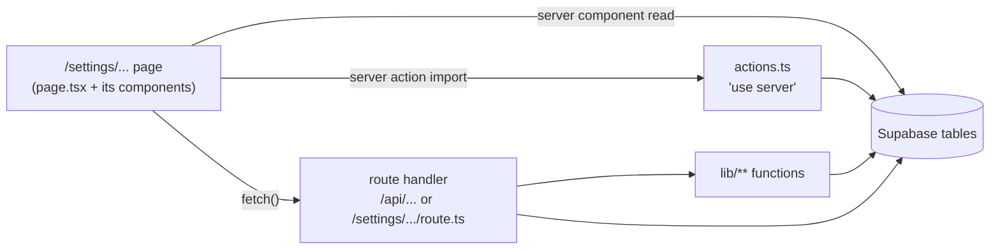
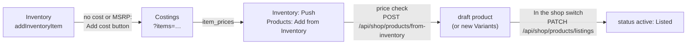
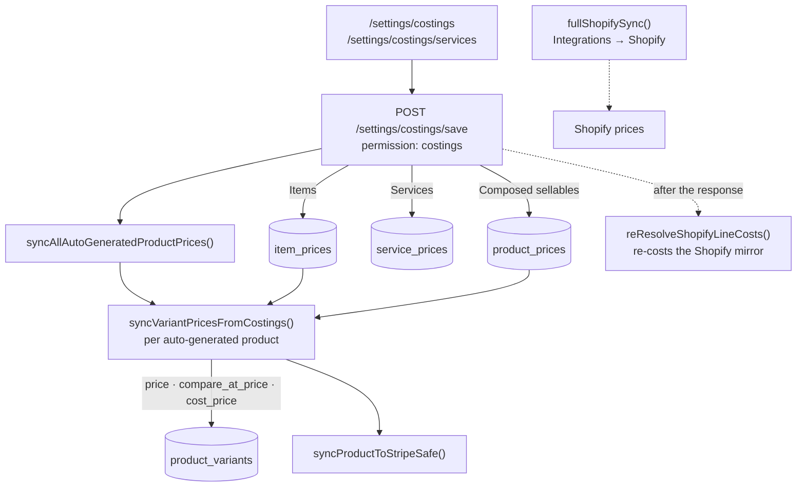

# Admin Panel (settings) → data

Which Admin Panel pages change which data, and how a price set in Costings
reaches the shop. This covers the pages that touch inventory, prices, products
and orders. For any other page, `graphify-out/DATA_LAYER.md` (section
"Pages") lists its server actions, endpoints and tables, and
`./scripts/graphify explain "/settings/<page>"` shows the same from the graph.

Terms follow `CONTEXT.md`. Verified by reading the code at commit `dfe7696`
(2026-10-22).

## How a page reaches the database

Pages write in two ways: server actions (most of Inventory and the Shopify
integration) and route handlers (everything else). Both check the caller's
permission first, with `assertAdmin(<permission>)` or the route's own check,
then write with the service-role client. Permissions are code; roles are data
(ADR 0023).

Cost price (`item_prices.cost_price`, and `product_variants.cost_price`, which
Costings projects from it) is shown and written only for a role holding
`costings` (owner, 2026-11-22). Inventory, Products, the product editor and
Add from Inventory answer every other role with no cost, write no cost
column for it (so a stored cost is kept), and refuse its request that sets
one. MSRP is not gated.

Cost captured at sale (`order_items.unit_cost` / `total_cost`) and margin
(`order_margins`) follow the same permission. A Result order line's
`customization_snapshot` no longer carries the build's `cogs` or a service
`costPrice` (customers can read it; the trigger in
`20261122130000_customers_never_see_costs` strips both on every write), and
the order detail still drops those keys for a role without `costings`, for
rows written before that migration is applied. Without `costings`, the order
detail, Orders list and Orders dashboard (page and `/api/shop/orders*`) send
no cost, COGS or margin and skip the `order_margins` read, and the Orders
pages drop the Unit cost column, Realized margin card, Margin column and Gross
margin tile. Analytics' Sales report sends only revenue, units, order and line
counts and Sales over time, and the tab becomes "Sales" with no margin cards,
Sales with no cost, or Margin by product / part. Prices paid, totals and
refunds are unchanged.

## Pages that touch inventory, prices, products and orders

| Page | Calls | Writes |
|---|---|---|
| **Inventory** `/settings/inventory` | Server actions `receiveStock`, `sellCart`, `sellPart`, `addInventoryItem`, `deleteInventoryItem`, `getInventoryCostingState`, image setters. Reads `items`, `inventory_balances`, `pillow_products`, `bom_lines`, `bolster_bom_lines` directly. The parts drawer links an unpriced family to Costings and pushes a priced one through `/api/shop/products/from-inventory` (below). | `inventory_transactions`, `items`, `item_prices` (opening price; removed when an Item is deactivated), product/variant images |
| **Configure** `/settings/inventory/configure`, `/settings/inventory/configure/[card]` | `…/configure/save`, `…/configure/templates`, `…/templates/[templateId]`, `…/fork`, `…/templates/apply`, `…/unpromoted` | `bom_lines`, `bolster_bom_lines` (fillings stripped, ADR 0003), the Default Filling Template, `bom_templates`, `bom_template_lines`, `filling_template_placements` / `bolster_template_placements` |
| **Costings** `/settings/costings` | `/settings/costings/save`; reads `/settings/costings/builds`. `?items=1,2` shows only those parts (the Inventory page's Add cost link). | `item_prices`, `product_prices` → `product_variants` price fields → Stripe (below) |
| **Costings → Services** `/settings/costings/services` | `/settings/costings/save` | `service_prices`, the re-adjustment policy in `site_settings` |
| **Products** `/settings/products` | `/api/shop/products/sync-inventory`, `/api/shop/products/resync-prices`, `/api/shop/products/from-inventory` (Add from Inventory: the push), `/api/shop/products/listings` (In the shop) | `products`, `product_options`, `product_variants`: the inventory projection, the push and the **Listed** switch |
| **Product editor** `/settings/products/[id]` | `/api/shop/products/[id]`, `…/variants`, `…/variants/[variantId]`, images | `products`, `product_variants` (`stock_quantity`, `track_inventory`), `product_images` |
| **Orders** `/settings/orders` | `/api/shop/orders` (list, dashboard) | Nothing |
| **Order detail** `/settings/orders/[id]` | `/api/shop/orders/[id]` (status), `/api/shop/orders/[id]/{deduct-stock, refund, cancel, refund-request, restock, fulfill, easyship, …}` | A status change that makes the Order sold, `deduct-stock`, `fulfill` and the courier's first scan of an Easyship label (the webhook ships the Order, ADR 0044) deduct its goods once (`inventory_transactions`, `orders.inventory_deducted_at`). `refund` (full, chosen lines or an amount, ADR 0038) asks Stripe for the money on every intent the Order was paid on and writes only `order_timeline` and `admin_audit_log`; the `charge.refunded` webhook writes `order_payments`, or `refund.updated` once a refund that settles later (PayNow) succeeds. `restock` writes `inventory_transactions` + `order_items.returned_quantity`. The "Inventory deducted" badge and the Stock row read `orders.inventory_deducted_at`. |
| **Result detail** `/settings/results/[id]` | `/api/results/assign/prep`, `/api/results/[id]/assign`, `/api/results/[id]/filling-mix` (GET the saved mix; POST saves one onto a Draft Result), `/api/results/[id]/cancel`, `/api/results/[id]/request-payment` | `mp_config_responses`, `result_filling_placements` / `result_bolster_filling_placements`. Stock is checked but not written. |
| **Integrations → Shopify** `/settings/integrations/shopify` | `fullShopifySync`, mapping and override actions | `shopify_variant_mappings`, `shopify_variant_overrides`; pushes stock and prices to Shopify |
| **Analytics** `/settings/analytics` | `getSalesReport`, `getInventoryMovementWaterfall` and other read actions | Reads Orders Stripe charged (money ledger) and the stock ledger ([analytics.md](analytics.md)); writes only SEO annotations and target queries |

## From Inventory to the shop

ADR 0045. An Item reaches the shop in four steps, one per page:

- **Costings first.** `costingGaps` (`lib/ecommerce/inventory-families.ts`): a sellable Item needs
  a cost and an MSRP, a build input a cost. Until then Inventory shows Add cost, which opens
  Costings on those Items.
- **The push** (`pushFamilyToProducts`, `lib/ecommerce/shop-listings.ts`) reloads the family by
  category and name, and `checkPushPrices` refuses it unless every size being pushed has both
  prices and Staff confirmed exactly those. A new family becomes a draft product
  (`publishAccessoryFamily`); a size new to Inventory becomes a Variant of the family's product
  (`addSizesToProduct`). Variant prices then come from Costings through `price_key`.
- **In the shop** (`listShopProducts`, `setProductListed`) lists the shop's products, not
  Inventory, and switches `products.status`. Listing re-syncs prices from Costings first and
  refuses an unpriced Variant.

How a sale and a restock move stock is in
[purchases-to-inventory.md](purchases-to-inventory.md) and
[inventory.md](inventory.md).

## Costings is the single source of sell price

ADR 0001 and ADR 0024: Costings owns cost, MSRP and compare-at. Every other
price is a mirror of it.

- **Items**: upserts `item_prices {cost_price, msrp, compare_at_price}`. A row
  with all three empty is deleted.
- **Composed sellables**: upserts `product_prices` on `key`. Pillows by size ×
  tier (premium also by fabric family), bolsters by length.
- **Build cost** is shown, never stored. A card has one cost per Filling
  Template serving its size: the composed BOM plus that template's Derived pack
  list, the sum `assembleBuild` makes. A premium fabric's build ships that
  fabric's case, and a Basic build leaves out a template's neck support and
  ear pad. On a Premium build both ship inside the pillow and their cost
  counts. A neck support's price is in the pillow's MSRP; an ear pad adds its
  own MSRP on top, and the margin counts it.
  `GET /settings/costings/builds` supplies the pack lists, because the
  placement tables are service-role only. `lib/costings/build-costs.ts` does
  the arithmetic.
- **Services**: upserts `service_prices` and writes the re-adjustment policy to
  `site_settings`. This skips the Variant/Stripe sync.
- **A stale edit writes nothing**: every Item row, Composed sellable row,
  Service and the re-adjustment policy the save sends carries its `base`, the
  stored values the page loaded when editing began. Before any write or sync
  the route compares each base with what is stored (Items: cost, MSRP and
  compare-at; Composed sellables: MSRP and compare-at, found the way the page
  finds them; Services: MSRP and cost) and, if any differ, answers 409 naming
  the rows. A row whose stored values already equal what is being saved is not
  a conflict: it is written and synced again, so a retry after a lost answer or
  a failed reload works. The page keeps what was typed through every reload and
  refreshes the rest. It holds two values per field: the latest stored price
  (what an untouched field shows, and what decides whether a field is an edit)
  and the base, the price editing started from. Only the user's Refresh moves a
  typed field's base; an automatic reload (`inventory:changed`) keeps it and
  says the stored price changed, so Save stays refused until Refresh. When a
  save answers, the base of each saved row becomes what was saved, before the
  page reloads. Check-then-write:
  a save landing between the route's read and its writes still wins
  (`ponytail:` in the route).
- **Variant mirror**: every `products.is_auto_generated` product resolves each
  Variant's price through `price_key`, `pillow_product_id`, bolster `option1`
  or `item_id`. It writes `price`, `compare_at_price` and BOM `cost_price`,
  then syncs the product to Stripe. The response returns any Variants it could
  not resolve.
- **Warnings, not silence**: a failed Stripe sync, a Variant price that could
  not be written, or a failed read (which writes nothing) still answers
  `ok: true`, with `stripe_warnings: [{ product, message, next }]` naming the
  product and its next step. The Costings save, Resync prices, Sync from
  Inventory, the In the shop switch and Add from Inventory all answer this way,
  and their screens show it as a warning toast that stays until closed
  (`lib/shop/stripe-warnings.ts`). `price-sync-results.check.ts` fails when
  code drops a reprice's result.
- **Campaign emails** read the Variant mirror at render, never a price of
  their own. A products block (or a button to a product) stores Storefront
  product ids only; the preview, the test send and every batch of a wave read
  each product's cheapest active Variant through the shop's columns
  (`readCampaignProducts`, lib/email-campaigns/products.ts), so a Costings save
  reaches the next email and changes no `email_campaigns` row. A product that
  is no longer Listed fails the checks before a wave, by name.
- **Shopify prices** are not pushed from Costings. Only a full Shopify sync
  pushes them: `fullShopifySync` (Integrations → Shopify) or
  `POST /api/shopify/sync?prices=1`.
- Costings never writes stock.
