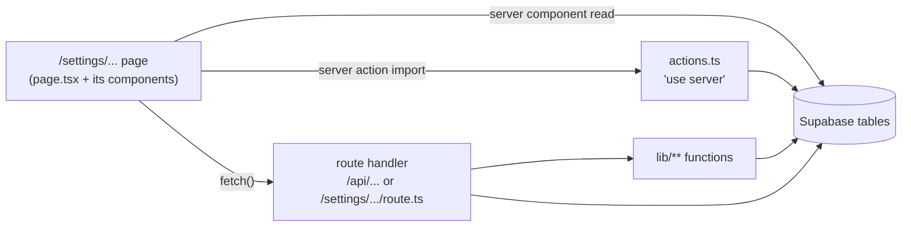
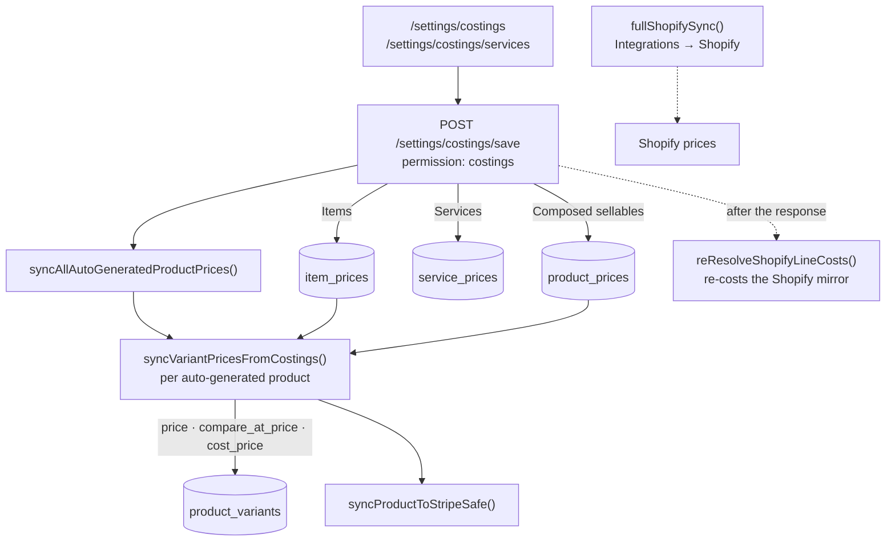

# Admin Panel (settings) → data

Which Admin Panel pages change which data, and how a price set in Costings
reaches the shop. This covers the pages that touch inventory, prices, products
and orders. For any other page, `graphify-out/DATA_LAYER.md` (section
"Pages") lists its server actions, endpoints and tables, and
`./scripts/graphify explain "/settings/<page>"` shows the same from the graph.

Terms follow `CONTEXT.md`. Verified by reading the code at commit `dfe7696`
(2026-10-22).

## How a page reaches the database

Pages write in two ways: server actions (most of Inventory and the Shopify
integration) and route handlers (everything else). Both check the caller's
permission first, with `assertAdmin(<permission>)` or the route's own check,
then write with the service-role client. Permissions are code; roles are data
(ADR 0023).

## Pages that touch inventory, prices, products and orders

| Page | Calls | Writes |
|---|---|---|
| **Inventory** `/settings/inventory` | Server actions `receiveStock`, `sellCart`, `sellPart`, `addInventoryItem`, `deleteInventoryItem`, image setters. Reads `items`, `inventory_balances`, `pillow_products`, `bom_lines`, `bolster_bom_lines` directly. | `inventory_transactions`, `items`, `item_prices` (opening price; removed when an Item is deactivated), product/variant images |
| **Configure** `/settings/inventory/configure`, `/settings/inventory/configure/[card]` | `…/configure/save`, `…/configure/templates`, `…/templates/[templateId]`, `…/fork`, `…/templates/apply`, `…/unpromoted` | `bom_lines`, `bolster_bom_lines` (fillings stripped, ADR 0003), the Default Filling Template, `bom_templates`, `bom_template_lines`, `filling_template_placements` / `bolster_template_placements` |
| **Costings** `/settings/costings` | `/settings/costings/save`; reads `/settings/costings/builds` | `item_prices`, `product_prices` → `product_variants` price fields → Stripe (below) |
| **Costings → Services** `/settings/costings/services` | `/settings/costings/save` | `service_prices`, the re-adjustment policy in `site_settings` |
| **Products** `/settings/products` | `/api/shop/products/sync-inventory`, `/api/shop/products/resync-prices`, `/api/shop/products/accessory-listings` | `products`, `product_options`, `product_variants`: the inventory projection and the **Listed** switch |
| **Product editor** `/settings/products/[id]` | `/api/shop/products/[id]`, `…/variants`, `…/variants/[variantId]`, images | `products`, `product_variants` (`stock_quantity`, `track_inventory`), `product_images` |
| **Orders** `/settings/orders` | `/api/shop/orders` (list, dashboard) | Nothing |
| **Order detail** `/settings/orders/[id]` | `/api/shop/orders/[id]` (status), `/api/shop/orders/[id]/{deduct-stock, refund, cancel, refund-request, restock, fulfill, easyship, …}` | A status change that makes the Order sold, `deduct-stock`, `fulfill` and the courier's first scan of an Easyship label (the webhook ships the Order, ADR 0044) deduct its goods once (`inventory_transactions`, `orders.inventory_deducted_at`). `refund` (full, chosen lines or an amount, ADR 0038) asks Stripe for the money on every intent the Order was paid on and writes only `order_timeline` and `admin_audit_log`; the `charge.refunded` webhook writes `order_payments`. `restock` writes `inventory_transactions` + `order_items.returned_quantity`. The "Inventory deducted" badge and the Stock row read `orders.inventory_deducted_at`. |
| **Result detail** `/settings/results/[id]` | `/api/results/assign/prep`, `/api/results/[id]/assign`, `/api/results/[id]/cancel`, `/api/results/[id]/request-payment` | `mp_config_responses`, `result_filling_placements` / `result_bolster_filling_placements`. Stock is checked but not written. |
| **Integrations → Shopify** `/settings/integrations/shopify` | `fullShopifySync`, mapping and override actions | `shopify_variant_mappings`, `shopify_variant_overrides`; pushes stock and prices to Shopify |
| **Analytics** `/settings/analytics` | `getSalesReport`, `getInventoryMovementWaterfall` and other read actions | Reads Orders Stripe charged (money ledger) and the stock ledger ([analytics.md](analytics.md)); writes only SEO annotations and target queries |

How a sale and a restock move stock is in
[purchases-to-inventory.md](purchases-to-inventory.md) and
[inventory.md](inventory.md).

## Costings is the single source of sell price

ADR 0001 and ADR 0024: Costings owns cost, MSRP and compare-at. Every other
price is a mirror of it.

- **Items**: upserts `item_prices {cost_price, msrp, compare_at_price}`. A row
  with all three empty is deleted.
- **Composed sellables**: upserts `product_prices` on `key`. Pillows by size ×
  tier (premium also by fabric family), bolsters by length.
- **Build cost** is shown, never stored. A card has one cost per Filling
  Template serving its size: the composed BOM plus that template's Derived pack
  list, the sum `assembleBuild` makes. A premium fabric's build ships that
  fabric's case, and a Basic build leaves out a template's neck support and
  ear pad. On a Premium build both ship inside the pillow and their cost
  counts. A neck support's price is in the pillow's MSRP; an ear pad adds its
  own MSRP on top, and the margin counts it.
  `GET /settings/costings/builds` supplies the pack lists, because the
  placement tables are service-role only. `lib/costings/build-costs.ts` does
  the arithmetic.
- **Services**: upserts `service_prices` and writes the re-adjustment policy to
  `site_settings`. This skips the Variant/Stripe sync.
- **Variant mirror**: every `products.is_auto_generated` product resolves each
  Variant's price through `price_key`, `pillow_product_id`, bolster `option1`
  or `item_id`. It writes `price`, `compare_at_price` and BOM `cost_price`,
  then syncs the product to Stripe. The response returns any Variants it could
  not resolve.
- **Campaign emails** read the Variant mirror at render, never a price of
  their own. A products block (or a button to a product) stores Storefront
  product ids only; the preview, the test send and every batch of a wave read
  each product's cheapest active Variant through the shop's columns
  (`readCampaignProducts`, lib/email-campaigns/products.ts), so a Costings save
  reaches the next email and changes no `email_campaigns` row. A product that
  is no longer Listed fails the checks before a wave, by name.
- **Shopify prices** are not pushed from Costings. Only a full Shopify sync
  pushes them: `fullShopifySync` (Integrations → Shopify) or
  `POST /api/shopify/sync?prices=1`.
- Costings never writes stock.
